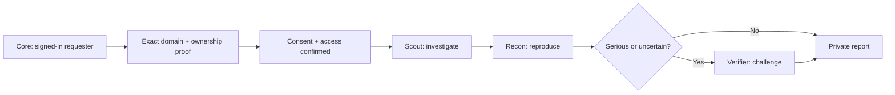
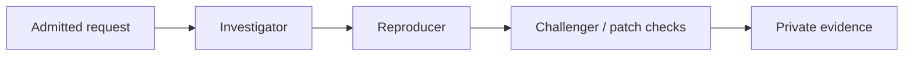

# Patchriot dispatcher

**The service that turns an approved website into a bounded assessment.**

The dispatcher verifies permission, assigns the agents, tracks progress and keeps the evidence private. A model can suggest a test; it cannot authorize a new target or override the saved limits.

[Use Patchriot ↗](https://patchriot.net) · [How a review works](https://patchriot.net/#/docs/workflow)



## What it owns

- **Permission:** exact HTTPS origins, request-specific DNS proof, consent and expiry. Redirects cannot widen scope.
- **Page dependencies:** optional exact HTTPS hosts saved in browser scope. Agents may read public assets there; they cannot log in, send account credentials or extend testing to them. Changes require new scope consent.
- **Work:** approved devices, queue capacity, bounded assignments, cancellation and retries. The agents stay on managed Kali machines.
- **Evidence:** private findings, tool records, disagreements and report deletion. Admin activity counts cover the full history, without loading report bodies.

**Core** owns accounts, NEAR Intents checkout and accounting. **Relay** runs beside Hermes and enforces access to tools and model inference. The optional NEAR AI report check reviews consistency and returns a signed receipt; it does not certify a finding as true.

## What customers see

A URL, domain verification, the named team, progress and a downloadable report. New live reviews use Scout for the full scoped investigation and Recon for targeted validation; no third role is added. Existing reviews keep their saved rules.

This repository is private while we develop the service. That is a development choice, not a security boundary: authenticated calls, exact scope checks and isolation protect the running system. Customer data and secrets are never repository content.

Optional two-account scopes bind the testing/reference distinction and password-change permission into the consent hash. Both credentials remain in the existing encrypted credential vault. Admission requires the pair to match that scope and a runner advertising `multi_account_v1`. Migration 32 permits the additional advertised capability. The relay enforces separate sessions and the limited testing-account mutation permission. Changing these permissions requires fresh scope consent.

Shared protocol validation accepts the additional scoped scanner receipts and verifies evidence-indexed coverage records. Deploy compatible core and dispatcher readers before adapter 21 runners. Existing receipts remain readable. Tool observations and deferred coverage are retained separately from validated findings.

## Operating reference

> **DON’T TRUST! VERIFY!** Review the implementation and test its permission checks before using your own deployment. Model confidence and signed reports do not prove a finding.

The details below are for deploying and inspecting the service. Public machines cannot join the managed beta. Approved operators handle assigned data outside the model’s TEE; do not describe the whole workflow as confidential computing.

<details>
<summary>Domain ownership before live testing</summary>

A saved live-test scope gets a fresh DNS TXT challenge for each exact domain. The challenge belongs to this requester and exact origins. Before checkout, setup can change with fresh consent; changed origins need new DNS proof. **Refresh DNS** starts a persisted five-minute check; repeated clicks do not extend it. Six windows per request are allowed. The worker checks at most eight due records per pass, four concurrently, with a four-second lookup timeout and a thirty-second retry interval.

Every domain must verify before the request automatically becomes eligible for checkout. Verification creates no work and spends no money; only the requester can select the team and pay or redeem a coupon. Staff can still reject or revoke a scope. Migration 17 advances existing, unexpired, fully verified pending requests; blocked and incomplete requests remain unchanged. Migration 22 gives new requests up to seven days for DNS setup, with no lookup until the requester clicks Check DNS. Successful verification narrows the saved expiry to at most 24 hours. Older deadlines are not extended; repeated checks cannot extend a verified permission. Scheduling, evidence access and renewal recheck the saved permission; expiry or revocation stops unfinished work. Proof never permits another account, another origin or arbitrary tools; consent still binds the current scope hash. Migration 13 also gives still-active older scopes fresh challenges; they do not bypass this gate.

The verifier uses the host’s DNS resolver. Permit DNS egress and configure a trusted resolver for the deployment. It looks up the exact `_patchriot.<domain>.` TXT name, combines chunks within one record, and requires an exact token match. Missing records, DNS failures and late replies never grant access. DNS control does not prove legal authority over everything reachable through a domain; staff still review scope and authorization.

</details>

<details>
<summary>Staff tests of owned sites</summary>

By default every live test needs DNS proof. For development, set `PATCHRIOT_OWNED_TEST_ORIGINS` to a JSON array of exact HTTPS origins you own or have explicit permission to test, for example `["https://staging.example.com"]`. Wildcards, paths, duplicate entries and implicit subdomains are refused. Keep this list short and remove it after testing.

A signed-in administrator can then open the request and choose **Staff: authorize our owned test site**, recording the owner's permission. Core forwards the write to `POST /internal/pentests/:id/authorize-owned-test` with the exact `scope_sha256` and a `note`. The database records the staff identity, time and note separately from DNS evidence. The request belongs to its original owner; consent, the approved team, payment and all network restrictions still apply. No work is created by authorization. Repeating a grant preserves its original expiry, at most 24 hours. Before checkout, an admin requester saving fresh permissions for the same configured origins retains the original staff grant and expiry. A member changing a staff-authorized scope or any requester changing origins needs fresh authorization. After checkout, changes require a new request.

Removing the configuration stops new grants. Revoke an existing request through its normal decision endpoint to stop waiting/running work and evidence access. An expired or revoked grant cannot be revived. Neither the agent gateway nor a member account can issue these grants. Deploy dispatcher and gateway with migration 22 before updating core.

</details>

<details>
<summary>Developer setup: run your own dispatcher</summary>

These instructions start a separate local installation. To request a website assessment, use the hosted beta at [patchriot.net](https://patchriot.net).

Keep `patchriot-core` beside this repository for the Apache-2.0 protocol crate. Use **Rust 1.94.1** and a dedicated **PostgreSQL 17** database.

| Private environment variable | Purpose |
| --- | --- |
| `DATABASE_URL` | Dedicated PostgreSQL connection |
| `PATCHRIOT_COMPUTE_GROUP_CONCURRENCY` | Active roles per operator/machine, 1 by default, range 1–4. Set the same value on dispatcher and gateway. Roles within one review remain sequential; lower limits let existing work finish. Measure memory and provider latency before increasing. |
| `PATCHRIOT_LIVE_REQUESTS_PER_DAY` | New live-test permission records per requester in a rolling 24 hours; default 10, range 1–100. Set on the internal dispatcher. Active-job, payment and execution limits remain separate. |
| `PATCHRIOT_LIVE_REVIEWS_PER_REQUESTER` | Unfinished reviews allowed when admitting a live test; default 3, range 1–30. Includes waiting, running and unpaid reservations. Set on the internal dispatcher. The global queue stays capped at 30; this does not increase simultaneous agent work. |
| `PATCHRIOT_INTERNAL_KEY` | Generated service secret, at least 32 bytes; shared with core |
| `PATCHRIOT_AUDIENCE` | Stable deployment identifier, e.g. `patchriot-local-v1` |
| `PATCHRIOT_BIND` | Optional listener; default `127.0.0.1:7411` |
| `PATCHRIOT_RELAY_BIND` | Optional agent-only listener for Tailscale Serve, e.g. `127.0.0.1:7412`; requires both listeners on loopback |
| `PATCHRIOT_AGENT_ATTEMPT_SECONDS` | Optional agent limit: `600` by default, at most `10800` |
| `PATCHRIOT_JEV_OPENROUTER_KEY` | Optional server-only OpenRouter key for consented request screening |
| `PATCHRIOT_NEAR_AI_KEY` | Optional server-only NEAR AI key for requester-approved report consistency checks |

```sh
cargo run --locked
```

Migrations are embedded. Use HTTPS or an authenticated tunnel outside loopback. Internal requests require the service secret plus account/role headers **constructed by core from its session**, never copied from a browser.

</details>

<details>
<summary>Connect agents over Tailscale</summary>

The website can stay on its public HTTPS address. Agent machines join a private tailnet and reach a separate **agent-only gateway**. Core continues using the internal listener. Use a dedicated deployment and database for each private organization; this is a manual setup path, not hosted tenant isolation. The commands below assume core and dispatcher share a service host or network namespace. Separate hosts need their own private internal connection; an agent gateway does not expose core's internal API.

```text
Browser → Core → internal dispatcher :7411
Agent → Relay → Tailscale HTTPS :443 → agent gateway :7412
```

1. Admit the dispatcher and approved agent machines to your tailnet. Apply [the example grants and policy tests](deploy/tailscale-policy.example.json) in the Tailscale admin console. They allow agents to reach the dispatcher on port 443. Review the whole policy: an existing broad allow rule can also grant access. Do not grant agent-to-agent, SSH, database or internal-port access just to make pairing work.
2. Set `PATCHRIOT_BIND=127.0.0.1:7411` and `PATCHRIOT_RELAY_BIND=127.0.0.1:7412`, then restart this service. Both ports must remain loopback-only. The second listener has health and device routes; `/internal/*` returns 404 even with the service key.
3. On that dispatcher machine, inspect existing Serve configuration before configuring a dedicated endpoint:

```sh
tailscale serve status
tailscale serve --bg --https=443 http://127.0.0.1:7412
```

Use **Serve**, which shares within the tailnet. Do not enable Funnel on this endpoint or proxy port 7411. Serve provisions HTTPS after tailnet consent; keep certificate checks enabled. See [Serve](https://tailscale.com/docs/features/tailscale-serve) and [grants](https://tailscale.com/docs/features/access-control/grants).

4. Set core's `PATCHRIOT_RELAY_ORIGIN` to the resulting `https://device.tailnet.ts.net` address. Keep `PATCHRIOT_DISPATCHER_URL` on the private internal connection. On each agent machine, run `patchriot-relay mesh-check --dispatcher https://device.tailnet.ts.net`, then use the ordinary pairing steps.

The relay signs the same requests as before. Tailnet membership does not approve a device, select an operator or grant a review lease. Revoking a device stops application access independently of the tailnet. No Tailscale login/header is trusted as a Patchriot account. If the connection drops, the existing lease deadline still stops work; there is no public-network fallback.

Leaving `PATCHRIOT_RELAY_BIND` unset preserves the existing local/internal setup. Network credentials belong in Tailscale's private machine state, never the repo, browser or model container. The example policy is a starting configuration; validate it against the actual tailnet before connecting operators.

</details>

<details>
<summary>What coordinates the agents?</summary>

**Rust schedules the work.** There is no lead Hermes agent in the dispatcher. Code checks permissions, records the agreed team and assigns investigator, reproducer and challenger roles. Workers use Hermes through the relay’s isolated adapter: local models for offline modes, or the explicitly configured hosted provider for live HTTP tests.

### Optional NEAR AI report check

With `PATCHRIOT_NEAR_AI_KEY` configured, the requester can ask for one advisory check of a finished live-test report. `POST /internal/reviews/:id/consistency-check` requires `{"accepts_near_ai":true}` and the requester's identity; staff cannot consent for someone else. `GET` returns its status and receipt to the requester or authorized staff. Migration 25 stores one durable attempt per report. Concurrent clicks reuse that attempt; interrupted or unverifiable completions are never purchased again automatically.

The checker sends bounded finding excerpts and request metadata to `Qwen/Qwen3.8-27B-abliterated`. Raw HTTP captures, query values and stored login credentials are excluded; excerpts can still contain sensitive details. Advice can flag possible duplicates or claims needing review. It cannot alter original findings, approve work, access a target or move funds. Existing deterministic grouping remains the report's source of counts.

The pinned [NEAR AI Rust SDK](https://docs.near.ai/cloud/inference-sdk/rust) checks fresh gateway/model attestation, requires UpToDate TCB status and GPU evidence, then verifies a provider-TEE signature over the exact request and response bytes. Gateway-only signatures, changed bytes and malformed advice are rejected. The downloadable receipt includes those bytes, hashes, signature and observed measurements. It does not include a portable hardware certificate chain or an audited source allowlist, identify a physical serving machine, attest the Kali agents or establish that findings are true. This integration uses verified HTTPS, not end-to-end encryption. See [response signatures and their limits](https://docs.near.ai/cloud/verification/cloud-api/response-signatures).

Checks run one at a time with a three-minute timeout and up to 8,192 output tokens, including the model's reasoning. Truncated answers remain unverified even when their visible JSON is valid. The provider key stays in dispatcher, never the agent gateway, browser or relay. The receipt follows the report's fixed 12-hour deletion clock, including queued inputs and late responses. Deploy migration 25 before the matching core UI; no relay update is required for this feature.

Adapter 16 can attach a versioned structured checklist to progress and final reports. Terminal public-stage outcomes require anonymous HTTP references and successful tool receipts; verified access cannot hide public gaps. Reused stages are checked against the saved earlier assignment's receipts and approved origins before admission. Missing/failed/truncated records cannot be promoted to completed reuse. Historical results without the optional field retain their format and legacy completeness policy. Deploy matching core, dispatcher/gateway, relay binary, then the rebuilt adapter 16 image; older readers reject the new field. These changes have local fixture coverage, not a new live benchmark.

Live testing uses one discovery pass followed by targeted reproduction and review. With relay adapter 9, only Scout must run the requested ARTEX engine. Later roles still need their own request evidence, a usable assessment, confirmed cleanup and any required authenticated/anonymous access checks. The dispatcher takes the role from its saved assignment. An incomplete Scout leaves the overall review incomplete; a failed engine run from an older follow-up worker also stays incomplete. Deploy this dispatcher before upgrading the relay image. Existing scopes and saved reports keep their format.

JEV is an optional, separate scope-screening call through OpenRouter. It receives only the consented scope and permission note, and cannot approve work or change tool permissions. Its decisions API is not interchangeable with a chat-completions model.

A lower-cost model can later help clarify a request or summarize evidence. Select it using owned security-review examples, including false-positive checks and legitimate tasks it refuses. A model advertised as uncensored is not a capability or reliability guarantee. Keep actual authorization, tool limits and payment rules in code. Private material must not be sent to a different provider without the required disclosure and consent.

<details>
<summary><strong>Run as a Linux service</strong></summary>

[deploy/patchriot-dispatcher.service](deploy/patchriot-dispatcher.service) runs as a dedicated `patchriot-dispatcher` user. Install a release built for the server's architecture at `/opt/patchriot/bin/patchriot-dispatcher`, owned by the administrator. Keep its private variables in `/etc/patchriot/dispatcher.env`, readable only by root; bind to loopback and start PostgreSQL first.

Install the unit in `/etc/systemd/system`, run `systemctl daemon-reload`, then `systemctl start patchriot-dispatcher`. Check `systemctl status patchriot-dispatcher` and `journalctl -u patchriot-dispatcher`; enable it at boot after testing. The unit bounds memory to 512 MiB and CPU to two cores, with a read-only system. Outbound DNS/HTTPS remains available for approved website collection; scope and destination checks still apply. SIGTERM stops admission and lets the collector finish within the 45-second service stop allowance.

</details>

</details>

<details>
<summary>Device lifecycle</summary>

**Pair → claim → manual approval → contribute → pause or revoke.**

Five-minute pairing codes are claimed once. Requests carry Ed25519 proofs binding the deployment, route, timestamp and typed payload. Persistent counters reject conflicting replays; exact heartbeat retries do not extend liveness. Devices become offline after 30 seconds without a fresh heartbeat. A revoked key cannot be reapproved.

Starting a signed challenge does not enroll a device. Core permits only administrators to claim new devices or retrieve connection details. The signed-in agent directory remains available to members. The directory shares approved devices’ OS/version, architecture, relay and runner versions, model, enabled website tools, report count and heartbeat. Private profiles, machine groups and assignments remain separate. Signed heartbeats update software details on already paired agents; these are declarations, not attestation. Older heartbeats remain valid. Deploy this dispatcher and its migrations before updating relays.

Approval must assess an operator and their agent's security-review, reproduction and **authorized penetration-testing capabilities** before private customer work. Pairing alone proves only control of a key.

The private device list includes `reports_received`, derived from completed leases with a saved result. A repeated delivery counts once; active, cancelled and expired assignments do not count. An accepted report can still contain incomplete or conflicting evidence. Counts are activity, not verified findings or earnings. Members receive counts only for their own devices; admins can see the fleet, without request contents in the list.

</details>

<details>
<summary>Review workflow</summary>

**Report retention:** core sends an authenticated `POST /internal/reviews/:id/download` with `{}` when a user explicitly exports a finished report. The first requester export sets a fixed twelve-hour deadline. Replays preserve it; staff exports and ordinary reads do not start it. After expiry all private report reads omit findings and evidence, and the existing 30-second cleanup task removes results and progress even with no browser/device traffic. A small work receipt keeps execution counts, model, scope/snapshot hash and completion metadata for payment accounting. Permission, job and payment records stay intact. Delivery retries cannot restore deleted results. Migration 23 applies the clock only after an explicit export, including older saved reports. PDFs/Markdown are browser-generated and have no separate stored copy. Operators must set their database backup/recovery retention separately; application deletion does not erase historical backups.

Live reports accept at most 8 MiB of compact JSON per role. The signed completion route adds a small envelope allowance; larger results are rejected before storage. Later roles can receive both preceding reports, and private detail reads can return all three. List responses contain no result bodies. Deploy core and dispatcher/gateway with these limits before upgrading relays; existing saved reports remain unchanged.



The current scenario, `access_control_v1`, is an owned access-control bug and supplied fix. `owned_fixture` uses compiled original/patch/clean-control checks; `owned_agent` asks a declared agent runtime to inspect and test the example. Each mode goes only to its matching runtime. Three distinct approved devices run sequentially. Evidence is **operator-reported**, not independently re-executed or a customer audit.

| Bound | Fixture check | Agent check |
| --- | --- | --- |
| Active reviews, including payment reservations | 3 per account, 30 overall | Same |
| Concurrent assignments | 1 per device and operator's declared compute group | Same |
| Assignment lease | 60 seconds, fixed | 60 seconds, renewable up to the saved attempt deadline (10 minutes by default) |
| Attempts | Up to 3 per role | Same |
| Review lifetime, including waiting/retries | 15 minutes | Three attempt budgets + 5 minutes; 35 minutes by default |

For a slow CPU pilot, `PATCHRIOT_AGENT_ATTEMPT_SECONDS=3600` permits 60 minutes per attempt and 185 minutes per review. The limit is saved at admission; changing configuration does not extend existing work or alter a paid reservation. Snapshot retention must cover payment waiting plus the full review. Operators must explicitly raise their relay limit too; their local cap can shorten an assignment.

**New live website tests use separate waiting and execution clocks.** Migration 21 preserves existing deadlines and applies the new policy only to newly admitted `pentest_agent` reviews. Each role gets its saved attempt allowance when assigned. The whole request expires no later than 24 hours after admission or funding, capped by domain permission and test-account expiry. Waiting does not consume the role allowance, but those permission deadlines can still stop unfinished work. Live tests do not automatically retry an interrupted role.

On a shared machine, the scheduler selects the oldest ready request across its assigned devices, regardless of which device polls first. Paid requests enter this order at funding; unpaid reservations receive no assignment. Paused, offline or incompatible assigned devices do not block unrelated ready work. The existing device/operator/compute-group lease prevents simultaneous assignments; no new instance or substitute operator is created. Review detail returns the number of earlier requests sharing its pending machines, without their identities or targets, plus the actual start and active-role deadline. Deploy dispatcher and gateway before using the new timing display in core.

Renewal requires a signed, increasing sequence, a current unexpired assignment and an approved, unpaused device. A fresh signed renewal proves presence for that lease. Heartbeat freshness controls admission to new assignments. Duplicate renewals return the existing expiry and remaining time. Cancellation, expiry and revocation stop renewal. Clients use a monotonic deadline and stop before losing the lease, including during a network outage.

All three checks must report the expected results to complete. Agent prose alone cannot pass: the result needs the original/fixed terminal observations, model-call count and confirmed cleanup. Missing or contradictory evidence produces **needs_review**. Cancellation and revocation reject late results; superseded attempts cannot complete replacements. Expiry is processed during polling and authorized queue reads. Shared-host/operator identities remain visible; model names and digests are declarations, not attestations.

</details>

<details>
<summary>API map</summary>

| Route group | Caller |
| --- | --- |
| `POST /v1/pairings/{start,status}` | Signed device |
| `POST /v1/devices/:id/heartbeat` | Paired device |
| `POST /v1/devices/:id/work/{poll,renew,complete}` | Approved, opted-in device |
| `POST /v1/devices/:id/work/evidence` | Selected device with a current private-review lease |
| `GET /v1/fleet` | Public aggregate counts |
| `POST /internal/pairings/claim` | Authenticated core account |
| `GET /internal/pairing-info` | Staff through core; managed-agent connection details |
| `GET /internal/agents` | Admitted account through core; limited agent metadata |
| `GET /internal/devices`; `POST /internal/devices/:id/decision` | Account/admin through core |
| `GET, POST /internal/reviews`; `GET /internal/reviews/:id`; `POST /internal/reviews/:id/cancel` | Requester/admin through core |
| `POST /internal/site-checks/:id/admit-review`; `POST /internal/reviews/:id/fund` | Core, acting as the paying requester |
| `GET, POST /internal/site-checks`; `GET /internal/site-checks/:id`; `POST /:id/cancel`; `GET /:id/evidence` | Requester/admin through core |
| `POST /internal/site-checks/:id/decision` | Admin through core |
| `GET /internal/site-checks/:id/compare/:baseline_id` | Requester/admin; both captures must be retained and share a requester and exact scope |
| `GET /internal/site-checks/:id/review-plan`; `POST /:id/review` | Plan: requester/admin; sharing consent: requester only |

Creating a fixture review takes `{"request_id":"<uuid>","scenario":"access_control_v1"}`; add `"mode":"owned_agent"` for the agent path. Account/request ID deduplicates the request; changing its mode is rejected. Cancellation takes `{}`. Renewal takes `{"lease_id":"<uuid>","sequence":1}`. Existing fixture requests, assignments and saved results remain compatible. Exact completion retries are accepted once; changed replays are rejected. The `/work/complete-gzip` companion accepts a gzip-encoded signed completion with the same replay and lease rules. Its signature binds that exact endpoint. Compressed input and expanded JSON are each limited to the 32 MiB result allowance plus 8 KiB envelope overhead; malformed and oversized input is rejected. Existing `/work/complete` clients remain compatible. Deploy this reader before enabling compressed uploads on runners. See [shared types](https://github.com/adaki2004/patchriot-core/blob/main/crates/protocol/src/lib.rs) and [review handling](src/reviews.rs).

### Reserve work before payment

Core can call `admit-review` with the requester's `consent`, a server-selected `price` (`asset` and smallest-unit `amount` as strings), and `payment_expires_at` (UTC seconds, at most one hour ahead). The saved review binds that price to the exact snapshot and three selected devices. It occupies a queue slot in **awaiting_payment**; no agent receives the work or its evidence.

After recording a matching settlement, core calls `fund` with `request_id`, `invoice_id` and the saved `price`. The dispatcher rechecks the agents, consent and retained snapshot, then starts the review deadline using its saved time budget. Repeated delivery acknowledges the same activation; one invoice cannot fund two reviews. Cancellation, expiry or removed approval prevents activation. Core retains responsibility for customer balances and refunds when work cannot start.

These routes require the internal service credential and paying account. They do not accept a browser's payment claim or verify a blockchain transaction themselves. Core's configured paid mode restricts the free path and handles browser checkout, quote preparation and funding-event delivery. Refund execution remains separate.

</details>

<details>
<summary>Access and scope checks</summary>

### Website evidence collector

The [collector](src/websites) captures an approved HTTPS homepage and up to four directly referenced scripts. It saves body hashes, selected security headers, inline scripts and explicit reasons for skipped content. Submission records the requester's authority claim; an admin verifies permission and approves that exact immutable scope before collection. The web server runs the collection worker automatically.

Scope allows the homepage origin plus up to three exact script origins. Every DNS answer must contain only allowed public addresses; connections are pinned to that set with normal TLS verification. Redirects, proxies, credentials and compressed responses are refused. Limits are 30 seconds overall, 256 KiB for HTML, 512 KiB per external script, 2 MiB of saved HTTP bodies and 40 script references. HTML with more than 8,192 raw `<` characters is refused before tree parsing, including characters inside comments and scripts. This bounds unusually dense markup; a legitimate complex page can also exceed it. No partial snapshot or security verdict is saved. Failed responses can consume network traffic without becoming saved evidence.

HTML parsing runs separately from API requests and lease checks, with at most one parser per dispatcher. Cancellation or the collection deadline stops waiting for its result. A parser already running can finish in the background and retains that slot until it exits; this is a concurrency limit, not a forced CPU stop. No late result becomes a saved snapshot.

This is **a limited snapshot, not a browser audit or a safety verdict**. It does not execute JavaScript, follow imports, log in or discover every request a browser would make. External hashes cover the exact response bytes; inline hashes cover parsed script text, with the original HTML retained. Integrity attributes are recorded, not certified. Use network egress filtering as a second boundary before public deployment.

Account/request IDs deduplicate submissions; changed scope is rejected. The pilot allows two pending/active requests and three submissions per day per account, ten overall per day, and one collection at a time across dispatcher instances. Approval expires after ten minutes. A 45-second lease recovers one interrupted attempt; retries never extend approval. Cancellation and expiry reject late results. During collection the worker checks its lease every second; already sent requests may finish.

Raw evidence is readable for seven days, then removed by the worker's sweep. Downloads check both ownership and retention in the database. Scope, decisions, status and small summaries remain in history. Collection itself does not spend funds or send evidence to agents.

Capture comparisons read both retained snapshots under the caller's permissions in one database query. They compare saved body hashes, sizes, content types, selected headers and script-reference records. They return no raw bodies, perform no target requests and start no agent work. Different collection times and CDN addresses alone do not count as content changes. A resource present in only one capture may have been skipped in the other; inline scripts match by HTML position. The result is evidence to inspect, never a safety verdict.

### Private website reviews

`website_agent` runs `website_snapshot_v1` through the same bounded queue, with three extra gates:

1. An admin grants **private-work approval** to a Hermes device, with a recorded reason. Existing demo approvals do not qualify.
2. Its signed poll explicitly declares `website_reviews: true`. Older polls retain their signature format and receive only demo work.
3. The dispatcher proposes three devices, ordered investigator/reproducer/challenger. The snapshot owner confirms that named team and the saved snapshot SHA-256. Operator, model and compute-group declarations are recorded with consent.

Selection, admission and payment activation require a fresh work poll within 30 seconds or a current, unexpired assignment. Heartbeats alone and replayed polls do not renew work availability. A busy agent stays eligible while renewing its lease; a relay restarted in presence-only mode ages out of the selection list. After migration, idle devices need one fresh poll before selection; existing signed request formats are unchanged.

The plan includes `recommended_device_ids`. Selection considers up to 200 eligible devices, preferring distinct operators, declared compute groups and models, then fewer queued roles and idle devices. Per-site tie-breaking avoids always favoring the oldest records. Planning does not reserve capacity; admission rechecks availability. Existing consent payloads and paid reservations remain valid. Deploy the dispatcher before the updated website, which requires a server proposal.

Roles stay pinned to those devices. No fallback operator receives the data. Only a live assigned lease can download the original snapshot and preceding reports; cancellation, expiry and revocation stop downloads and renewals. Paused or stale devices cannot read evidence. Removing private approval fails active reviews involving that device. Data already received cannot be recalled.

The relay reviews saved text without network access. Completion checks the snapshot binding, tool observation, bounded report and exact quotations. `evidence_complete` describes these checks; it does not certify security reasoning, exploitability or a proposed fix. Incomplete evidence stays `needs_review`. All three reports being complete is not a safety verdict or proof of independent operators. Reports can retain short quotations after raw-body retention ends.

### Access and execution

**JEV request screening:** the requester may consent to sharing their scope and permission note with TypeSafe JEV through OpenRouter. This sends no collected page, source file, credentials or account profile. Old requests stay manual-only. One background worker evaluates consented requests, with a 15-second HTTP limit, 32 KiB response limit and at most two attempts after interruption. Failed, malformed or missing-provider results are marked unavailable; they never become approvals.

The [Rust client](src/screening.rs) uses OpenRouter's [decisions API](https://openrouter.ai/blog/tutorials/jev-vs-llm-when-to-use-each/), with three checks: current scope, attempted rule bypass and harmful intent. The saved result records the model, input/rubric hashes and policy version. Pilot thresholds only flag closer review; they are not calibrated odds. Admin approval waits for a requested check to finish, then still requires an independent authority check and a recorded reason. Cancellation discards late results. No result can authorize a tool or alter payment rules. Deploy dispatcher before the updated UI.

- **Core owns accounts and money.** Dispatcher cannot create credit or choose rewards. Paid admission uses saved terms and accepts each invoice once; only core can confirm settlement.
- **Private access is checked on every read.** Assigned operators, service staff and approved providers can see assigned plaintext. No automatic publication of customer findings.
- **Scope is enforced in code.** Website admission must verify authority before collection. An agent or webpage cannot expand approved hosts, actions, rates or time.
- **Tools need a sandbox.** Source, hooks, installers and agent instructions are untrusted. The pilot uses approval, scope checks and isolated execution. Request screening is advisory; it cannot grant permissions, remove isolation or move funds.
- **Evidence beats votes.** Future customer findings need independent reproduction and meaningful before/after patch tests. Missing evidence stays unresolved.

Google login and stronger patcher/admin authentication belong in core. Broader customer artifacts and recurring checks follow. Recurring jobs must recheck scope, funds and capacity on every occurrence; missed runs must not create a burst.

</details>

<details>
<summary>Verify it</summary>

GitHub checks run when a ready PR targets `main` and when that PR changes. Draft PRs and ordinary branch pushes do not run checks; newer PR commits cancel superseded runs. Run the commands below locally while developing.

Set `PATCHRIOT_TEST_DATABASE_URL` to a local test database whose role can create schemas.

```sh
cargo fmt --all --check
cargo clippy --locked --all-targets -- -D warnings
cargo test --locked --all-targets
```

The PostgreSQL tests cover concurrent claims/polls, account isolation, replay, capacity, expiry, cancellation, revocation and conflicting evidence. Core's `scripts/smoke-reviews.py` adds real relay processes and a deliberately lost result reply.

Private core access in CI needs a `READ_TOKEN` Actions secret with read-only access to core. An existing `PATCHRIOT_READ_TOKEN` secret also works and takes precedence. No credential value belongs in source.

This repository is private initially while admission and review policy evolve; secrecy is not a security boundary. See [LICENSE](LICENSE) and [NOTICE](NOTICE).

</details>

<details>
<summary>Private source uploads</summary>

Core sends bounded text to `/internal/sources`: 1–12 UTF-8 files, at most 16 KiB each and 48 KiB total. Files are stored as JSON in PostgreSQL; names are never opened or extracted as paths. Intake rejects archives, binaries, hidden/unsafe paths and common credential markers. These checks do not replace removing secrets before upload.

An admin approves the immutable bundle. The owner then confirms three eligible devices; each needs private-work approval and the separate signed `source_reviews: true` opt-in. The `source_agent` mode uses the existing sequential roles, capacity limits, saved deadlines and payment gate. Older polls preserve their signatures and cannot receive source work.

Only a live assigned lease can read `/v1/devices/:id/work/source-evidence`. The relay uses adapter 4 or 5 to inspect source excerpts without model tools, network access or code execution. Exact quoted text and file hashes are checked on completion; matching evidence does not establish correct security reasoning. No JEV provider receives source files in this slice.

Raw bundles expire after seven days. Owner deletion cancels unfinished reviews and removes raw files; metadata, decisions and reports remain. The periodic collector and queue cleanup remove expired bytes. Revocation stops further reads, renewals and results, but cannot recall data already seen. Intake caps are five retained uploads and 20 daily submissions per owner, with 200 retained globally.

</details>

<details>
<summary>Live website pilot</summary>

Core can reserve a live assessment through `POST /internal/pentests/:id/admit-review`. It stays `awaiting_payment` until core confirms the matching settlement. Admission requires domain proof, scope approval, the named team and separate provider consent. Funding rechecks permission and team availability; it cannot extend an expired scope or restart cancelled work. Coupons use the existing idempotent start after core reserves the code.

`pentest_agent` / `live_http_v1` is separate from snapshot collection. Migration `0012` stores an immutable origin/method/objective scope, owner permission note, admin decision and 24-hour expiry. The owner approves a disclosed pool of eligible devices with the signed `live_tests` opt-in and separately consents to operator access and the inference providers shown for the team. Existing device polls omit that flag and remain compatible.

Internal routes are `GET/POST /internal/pentests`, `POST /internal/pentests/:id/decision`, `GET /internal/pentests/:id/review-plan` and `POST /internal/pentests/:id/review`. Core applies its configured pilot, coupon or paid-access mode. A browser cannot claim that a payment settled.

New live requests explicitly save `use_worker_pool: true`. Migration `0033_ready_role_fifo.sql` records when each role becomes ready: after funding for Scout and after the preceding report for later roles. Among eligible ready roles, the scheduler preserves each audit's original admission position (funding for paid audits), so its ready Recon can run before a newer Scout. Waiting roles never reserve workers. Assignment is atomic to a free worker from that saved pool, under the existing host concurrency limit. A device cannot handle multiple roles in the same review. Device, operator, model, declared host, private approval, scope and tool capability remain checked; pool membership alone never grants an evidence download. Older requests retain their pinned assignments. Upgrade all eligible relays before offering pooled checkout.

Roles run sequentially. Only their active device lease can download scope and prior reports at `/v1/devices/:id/work/pentest-evidence`. The agent-only gateway exposes that signed route, never the internal admin routes. Scope expiry, permission revocation, cancellation or removed device approval blocks further evidence access and renewals. There is one execution attempt per live role; result delivery can retry without running the model again.

The relay restricts target requests to approved HTTPS origins and public IPs, records HTTP evidence, and keeps the hosted-provider key outside the agent container. The dispatcher validates report bounds, scope and cited evidence IDs. `evidence_complete` means the required report material arrived; it does not prove a vulnerability or certify operator honesty. Missing or conflicting evidence still needs review. Returned live reports retain bounded excerpts in private history.

</details>

<details>
<summary>Container deployment</summary>

The dispatcher image needs the shared protocol crate from a matching core checkout. Create a small build context outside both repositories:

```sh
python3 scripts/prepare-deploy.py --core ../patchriot-core --output ../dispatcher-build
docker build -t patchriot-dispatcher:local ../dispatcher-build
```

The helper copies Rust source and manifests, excludes environment/key files and refuses to overwrite an existing directory. Run `railway up ../dispatcher-build` for the selected private dispatcher service once its runtime variables are configured. Keep that build directory private and outside Git. Set `DATABASE_URL`, `PATCHRIOT_INTERNAL_KEY` and `PATCHRIOT_AUDIENCE`; optional screening uses `PATCHRIOT_JEV_OPENROUTER_KEY`. The image listens on port `7411` and runs as an unprivileged user.

**Do not attach a public domain or TCP proxy to this service.** Core reaches it through Railway's private network. Remote agents use a separate agent-only gateway; an internal Railway URL is not reachable from their VPS.

### Separate hosted agent gateway

For agents connecting through Railway HTTPS, build the **gateway image** for a separate service:

```sh
docker build --build-arg PATCHRIOT_IMAGE=gateway -t patchriot-agent-gateway:local ../dispatcher-build
```

Set `PATCHRIOT_IMAGE=gateway` for the Railway build, the dispatcher's private `DATABASE_URL`, and the same `PATCHRIOT_AUDIENCE` and `PATCHRIOT_AGENT_ATTEMPT_SECONDS`. Attach an HTTPS domain to gateway port `7412`, then use it as core's `PATCHRIOT_RELAY_ORIGIN` and the managed relays' dispatcher URL. The image runs unprivileged and has no persistent volume or Tailscale dependency. It explicitly sets `PATCHRIOT_GATEWAY_BIND=[::]:7412`; the standalone binary otherwise defaults to loopback. TLS terminates at Railway's proxy, so do not expose a raw HTTP/TCP listener to the internet.

This service contains only device routes and health/fleet summaries. It has no internal-service key, admin routes, model credentials or background workers. Device signatures, staff pairing and approval, requester consent, scope checks and leases still apply. A public gateway does not enable public contributor enrollment. Pairing admission and body sizes are bounded; configure edge request limits before rollout. Treat its address as discoverable: keeping an IP or hostname out of the UI is not authentication.

Use the private mesh configuration below when agents should connect only from an admitted network. Do not run `mesh-check` against an ordinary public HTTPS gateway; that command specifically verifies a Tailscale connection.

### Optional private mesh

For separate Railway services, run the companion **mesh image** beside the main dispatcher. It shares the dispatcher database and audience, uses the same signed device handlers, and has no internal service key or admin routes. Only the main dispatcher runs DNS verification, screening and collection workers. Existing same-host Tailscale setups can continue using the two-listener configuration above.

```sh
docker build --build-arg PATCHRIOT_IMAGE=mesh -t patchriot-gateway:local ../dispatcher-build
```

On Railway, select this image with the build variable `PATCHRIOT_IMAGE=mesh`. Set `DATABASE_URL` to the dispatcher's private database and use the same `PATCHRIOT_AUDIENCE` and `PATCHRIOT_AGENT_ATTEMPT_SECONDS`. Set `TS_AUTHKEY` to a private, tagged Tailscale key approved for `tag:patchriot-dispatcher`; enable tailnet HTTPS and apply the grants above. Do not give this service core's internal key, model credentials or treasury keys.

Mount a dedicated persistent volume at `/var/lib/tailscale`. [Railway mounts volumes as root](https://docs.railway.com/volumes#permissions); set `RAILWAY_RUN_UID=0` on this gateway service only. The entrypoint prepares that exact directory as `65534:65534`, mode `0700`, then drops to UID/GID 65534, clears groups and all Linux capabilities, and enables `no_new_privs` before starting either service. It rejects an alternative path or symlink during root initialization and does not change existing files recursively. Other platforms can retain the image's default nonroot user with a correctly owned volume. Keep machine state across releases so the tailnet address stays stable. `/tmp` must be writable for the local socket. The image pins Tailscale 1.104.4 and uses userspace networking, without `/dev/net/tun` or privileged mode.

The gateway listens only on `127.0.0.1:7412`; `deploy/serve.json` shares it over private Tailscale HTTPS on port 443 with Funnel disabled. No public Railway domain or TCP proxy belongs on this service. The launcher stops both processes if either exits, and its container health check requires both local services. Set core's `PATCHRIOT_RELAY_ORIGIN` to the resulting tailnet HTTPS address, then run the relay's `mesh-check` from each admitted agent host before pairing. Network admission still does not approve a device or grant access to customer work.

Check a built gateway locally with `PATCHRIOT_GATEWAY_TEST_IMAGE=patchriot-gateway:local python3 -m unittest discover -s scripts -p 'test_*.py'`. The image checks use disposable volumes and no network credentials to verify privilege removal, persistence and rejection of redirected state paths. They are skipped when the image variable is unset; tailnet enrollment still needs a separate deployment check.

**Optional live engines:** migration `0016` stores the signed `live_tools` capability advertised by each relay. Empty or omitted capabilities retain baseline-only behavior. The `artex_engine_v1` choice is bound to the immutable scope; team selection, payment activation, leases, evidence access and renewal all require it. `GET /internal/pentest-tools` exposes availability to an authenticated core session, not private worker details. A missing, failed or incomplete engine record prevents complete evidence; partial reports remain available for review. Deploy the updated dispatcher before relays advertise the new capability.

### Encrypted test accounts

Set `PATCHRIOT_CREDENTIAL_KEY` to the same 32 random bytes, hex encoded, on the dispatcher **and** its relay gateway. Keep it in the deployment secret store; core, browsers and agent containers do not receive this key. Without it, authenticated assessment is unavailable. Migration 19 adds authenticated ciphertext and expands capability storage for the new runner. Deploy it before adapter 8 agents. Changing the key makes retained credentials unreadable: let active work finish first, then require fresh test-account requests after rotation.

`CreatePentest` may include a Basic or bearer `credentials` object. Its kind, protected GET `auth_check_path` and `authenticated_http_v1` capability must match the immutable scope. An active POST scope additionally requires `accepts_state_changes: true` and `active_web_v1`; older scopes remain read-only. Public account/history responses never contain credentials. Only the approved assigned device's current lease can read them. Ciphertext is bound to the account, request and scope using AES-256-GCM, with a fresh nonce. A credential set serves one assessment; completion, cancellation, revocation or expiry deletes it. A 30-second cleanup loop handles expiry even without device polls. Deletion does not erase an operator's prior copy.

**Rolling upgrades:** update core before exposing new capability names, then update dispatcher/gateway, then the relays. Old core versions reject unknown capability names. Advanced options become available only when all selected components support them.

For the hosted calibration run, `PATCHRIOT_AGENT_ATTEMPT_SECONDS=3600` is set on both dispatcher and gateway. Relays also use `max_attempt_seconds=3600`. The shared protocol accepts up to 200 model calls per role; relays enforce the actual call and cost allowance. Migration 20 widens the saved allowance without changing existing rows. Upgrade core and both servers before expanded-budget relays so their progress and reports are not rejected. Existing requests keep their saved deadlines.

Automatic HTML login uses `form_discovery_v1`. Migration 26 allows relays to advertise it alongside the four existing capabilities. Admission, assignment and lease checks require that exact capability, so older workers cannot receive automatic-login work. Deploy updated core, then dispatcher, then relays. The owner-selected login page is part of the consented scope, which locks at checkout; credentials are still supplied separately after ownership verification. The relay discovers one form under that permission, not through model-selected destinations.

Session login uses the `session_login_v1` capability and immutable form/JSON endpoint settings in the scope. Migration 24 allows the fourth advertised capability; older workers are not eligible for these requests. A target can be saved without its secret. After DNS proof or an explicit owned-site staff grant, only its requester may call `POST /internal/pentests/:id/credentials` with `{scope_sha256, credentials}` before any review is admitted. The existing encrypted store and 24-hour/permission limit apply. Replacing an account never alters the scope or revives completed/cancelled work. Admission and account updates share the scheduler lock. API clients that supplied credentials during creation remain supported.


Live candidates may declare `abliterated-model-large-v2` (Abliteration) or `abliteration-abliterated-model-large-v2` (Venice). A device declaration is immutable: switching routes needs a new paired and approved identity. Admission saves the selected declarations and provider list; polling and result acceptance require that model. A valid result from the other provider is still rejected for the wrong device. These two routes share one model family when ranking diversity. A backup requires the separate saved permission described below; no replacement operator is authorized. Upgrade core before advertising a Venice device; existing jobs retain their original team.

### Conditional live review

New live plans offer `investigate_validate_v1`: two named devices, full investigation followed by targeted validation, with no third role. Migration 31 permits explicit allowances up to three hours per role; saved reservations remain unchanged. Older `investigate_verify_v1` requests keep two required roles plus a third for serious findings, disagreement, unchecked claims or incomplete evidence. All three devices are named and checked at consent/funding; only the first two jobs are created initially. After their reports arrive, one completion transaction records the decision and, if necessary, queues the reserved third device. Results and reasons remain private. Cancellation, permission expiry and revocation still stop work. An incomplete earlier stage is never hidden by a later result.

Missing `review_policy` keeps the original three-role behavior, including existing paid orders. Snapshot and source reviews reject the live-only policy. Upgrade dispatcher and gateway before the new core checkout. The shared protocol defines the policy; there is no model vote that can change permissions, pricing or the selected team.

### NEAR recovery through Venice

For new requests, `PATCHRIOT_INFERENCE_PRIMARY_MODEL` optionally limits selection to approved devices declaring that model. `PATCHRIOT_INFERENCE_SECONDARY_MODEL` optionally offers the other supported DeepSeek provider as a backup. Both NEAR → Venice and Venice → NEAR are supported; omit secondary to disable fallback. Supported models are `deepseek-ai/DeepSeek-V4.1-Flash-1017-abliterated` and `deepseek-v4-1-flash-1017-uncensored`. A secondary without a primary, an unknown model or an unsupported pair stops startup. No new route order is assumed when both settings are absent.

Configure matching primary credentials and optional `secondary_model` / `secondary_key_file` on the relays before offering the route. Settings are private deployment configuration. Existing paired model declarations cannot change; switching to a new primary needs approved devices for that model. Do not retire devices with queued work. Deploy core, dispatcher/gateway and relay before enabling the new settings; older services cannot accept the new consent/model.

New consent saves the exact optional `fallback_model`. Coupon/payment replay cannot add or change it, and the gateway rejects a receipt for an unapproved backup. Changing deployment configuration affects only new admission. Relays preserve spending/call/time limits and require NEAR encryption, attestation and signatures whenever that route is used. The optional NEAR report check remains a separate feature.

Legacy `PATCHRIOT_VENICE_FALLBACK_ENABLED=true` and `allows_venice_fallback` still support the original NEAR-to-Venice route. Do not combine that flag with the new settings. Old serialized consent and receipts are unchanged. No migration is needed.

</details>


### Editing setup before checkout

`POST /internal/pentests/:id/setup` is requester-only and requires the current scope hash and fresh consent. The scheduler lock serializes edits with admission. Changed origins clear authorization and create fresh DNS challenges; same-origin changes retain current DNS proof without extending expiry. Changed permissions delete saved credentials. Any admitted assessment, including an unpaid or cancelled one, locks the setup.

Production-risk consent uses `web_active_v2` and requires `active_web_v2` agents; existing V1 scopes retain their exact instructions and hashes. Deploy core before exposing new capabilities, then migration 27 on dispatcher/gateway, then adapter 12 relays. The extra capability is unavailable until enough eligible agents advertise it.

### Wallet target access

`wallet_login_v1` is an explicit grey-box capability. The saved scope binds the two same-origin SIWE endpoints, chain and verification format. After ownership verification, the requester saves `{ "kind": "wallet" }` through the normal credentials route to authorize fresh, unfunded relay wallets. No wallet key is stored or accepted. Admission, expiry, revocation, payment and assigned-lease checks remain the same; old agents cannot claim this work. Migration 28 permits the seventh advertised capability. Deploy core, dispatcher and gateway before upgrading relays; availability requires three eligible devices. Supported HTTP formats and limits are in core’s README.


### Browser-discovered target login

New `browser_login_v1` scopes contain an optional entry path, not a site's API layout. The requester still supplies a dedicated account/token or authorizes a fresh unfunded EVM wallet after ownership verification. The existing encrypted credential store, requester consent, leases, cancellation and payment rules apply.

Migration `0029_browser_login.sql` permits eight advertised tool capabilities. Deploy core, dispatcher and its gateway before adapter 13 relays advertise the new name. Selection, payment activation and leases require eligible browser-capable agents; availability needs three. The relay also requires the inspected browser image and host sandbox profile. Existing HTTP form/JSON and SIWE scopes remain valid and keep their original hashes.

Complete authenticated evidence requires a relay-produced comparison of the same resource with and without access: 2xx versus 401/403, or a matching account identity absent/different anonymously. The dispatcher checks the recorded references and proof shape; it does not independently replay the target requests or attest operator honesty. Missing proof leaves authenticated coverage incomplete. Core's report and exports show that gap. Cookie/signature creation alone never satisfies it.

## Final confirmation and requester context

`POST /internal/pentests/:id/prepare` accepts exact `StartPentest` consent, `terms_version: "testing-risk-v1"`, optional `testing_context` (4,000 UTF-8 bytes), and optional Basic `environment_gate` credentials. Core proxies this behind session/Origin/CSRF checks. Preparation requires current target authority, binds the full consent and request ID, and starts no work or payment. Admission requires the accepted preparation within 30 minutes. Exact retries reuse it; edits need a fresh request ID. At most 50 confirmations and five nonempty screenings per requester per hour are allowed, with eight simultaneous screenings globally. Missing provider configuration, malformed replies and uncertainty fail closed for nonempty context.

Migration 34 adds private confirmation records and the `run_context_v1` worker capability. OpenRouter uses `PATCHRIOT_JEV_OPENROUTER_KEY` only on the internal dispatcher. Live-context classification is separate from the older homepage-only triage: it allows authorized target-secret exposure checks and supplied-account comparisons. Thresholds are classifier policy, not proof against prompt injection. Keep the exact relay scope, pinned DNS, network isolation, method permissions and secret separation authoritative even if classification accepts hostile input.

Gate credentials use the existing vault with separate request/account/scope authenticated-encryption binding. They are absent from preparation responses, public scope and model input, and available only through active-lease evidence. Cleanup removes their ciphertext after expiry or terminal work. Deploy compatible protocol readers and migration before adapter 22 workers; old scopes and saved reports retain their existing wire representation.
