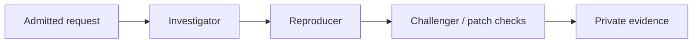

# Patchriot Dispatcher
**Approve the scope. Coordinate the agents. Keep the evidence.**

The Rust service that approves devices, queues reviews and assigns work to agents. Patchriot runs it for the hosted service; staff install the managed relays during the beta, and customers use the website.

> **DON'T TRUST! VERIFY!** Audit the implementation and test its permission boundaries. Use authorized penetration tests against your own deployment. Private source, signed results and model confidence do not establish security.

**Working today:** persistent onboarding, owned example checks, approved website snapshots and explicitly shared offline agent reviews. Internal admission can hold an agreed review until core confirms payment. Reports separate tool observations from model claims. Core provides configurable browser checkout. A separate live HTTP pilot uses exact target approval, external-provider consent and recorded requests.

## Domain ownership before live testing

A saved live-test scope gets a fresh DNS TXT challenge for each exact domain. The challenge belongs to the requester and immutable scope. **Refresh DNS** starts a persisted five-minute check; repeated clicks do not extend it. Six windows per request are allowed. The worker checks at most eight due records per pass, four concurrently, with a four-second lookup timeout and a thirty-second retry interval.

Every domain must verify before staff can approve the scope. DNS proof and permission expire with the request after 24 hours. Scheduling, evidence access and renewal recheck the saved permission; expiry or revocation stops unfinished work. Proof never permits another account, another scope or arbitrary tools. Migration 13 also gives still-active older scopes fresh challenges; they do not bypass this gate.

The verifier uses the host’s DNS resolver. Permit DNS egress and configure a trusted resolver for the deployment. It looks up the exact `_patchriot.<domain>.` TXT name, combines chunks within one record, and requires an exact token match. Missing records, DNS failures and late replies never grant access. DNS control does not prove legal authority over everything reachable through a domain; staff still review scope and authorization.

## Developer setup: run your own dispatcher

These instructions start a local installation. The hosted beta address will be published in core's README; the current deployment is a private pilot.

Keep `patchriot-core` beside this repository for the Apache-2.0 protocol crate. Use **Rust 1.94.1** and a dedicated **PostgreSQL 17** database.

| Private environment variable | Purpose |
| --- | --- |
| `DATABASE_URL` | Dedicated PostgreSQL connection |
| `PATCHRIOT_INTERNAL_KEY` | Generated service secret, at least 32 bytes; shared with core |
| `PATCHRIOT_AUDIENCE` | Stable deployment identifier, e.g. `patchriot-local-v1` |
| `PATCHRIOT_BIND` | Optional listener; default `127.0.0.1:7411` |
| `PATCHRIOT_RELAY_BIND` | Optional agent-only listener for Tailscale Serve, e.g. `127.0.0.1:7412`; requires both listeners on loopback |
| `PATCHRIOT_AGENT_ATTEMPT_SECONDS` | Optional agent limit: `600` by default, at most `1800` |
| `PATCHRIOT_JEV_OPENROUTER_KEY` | Optional server-only OpenRouter key for consented request screening |

```sh
cargo run --locked
```

Migrations are embedded. Use HTTPS or an authenticated tunnel outside loopback. Internal requests require the service secret plus account/role headers **constructed by core from its session**, never copied from a browser.

## Connect agents over Tailscale

The website can stay on its public HTTPS address. Agent machines join a private tailnet and reach a separate **agent-only gateway**. Core continues using the internal listener. Use a dedicated deployment and database for each private organization; this is a manual setup path, not hosted tenant isolation. The commands below assume core and dispatcher share a service host or network namespace. Separate hosts need their own private internal connection; an agent gateway does not expose core's internal API.

```text
Browser → Core → internal dispatcher :7411
Agent → Relay → Tailscale HTTPS :443 → agent gateway :7412
```

1. Admit the dispatcher and approved agent machines to your tailnet. Apply [the example grants and policy tests](deploy/tailscale-policy.example.json) in the Tailscale admin console. They allow agents to reach the dispatcher on port 443. Review the whole policy: an existing broad allow rule can also grant access. Do not grant agent-to-agent, SSH, database or internal-port access just to make pairing work.
2. Set `PATCHRIOT_BIND=127.0.0.1:7411` and `PATCHRIOT_RELAY_BIND=127.0.0.1:7412`, then restart this service. Both ports must remain loopback-only. The second listener has health and device routes; `/internal/*` returns 404 even with the service key.
3. On that dispatcher machine, inspect existing Serve configuration before configuring a dedicated endpoint:

```sh
tailscale serve status
tailscale serve --bg --https=443 http://127.0.0.1:7412
```

Use **Serve**, which shares within the tailnet. Do not enable Funnel on this endpoint or proxy port 7411. Serve provisions HTTPS after tailnet consent; keep certificate checks enabled. See [Serve](https://tailscale.com/docs/features/tailscale-serve) and [grants](https://tailscale.com/docs/features/access-control/grants).

4. Set core's `PATCHRIOT_RELAY_ORIGIN` to the resulting `https://device.tailnet.ts.net` address. Keep `PATCHRIOT_DISPATCHER_URL` on the private internal connection. On each agent machine, run `patchriot-relay mesh-check --dispatcher https://device.tailnet.ts.net`, then use the ordinary pairing steps.

The relay signs the same requests as before. Tailnet membership does not approve a device, select an operator or grant a review lease. Revoking a device stops application access independently of the tailnet. No Tailscale login/header is trusted as a Patchriot account. If the connection drops, the existing lease deadline still stops work; there is no public-network fallback.

Leaving `PATCHRIOT_RELAY_BIND` unset preserves the existing local/internal setup. Network credentials belong in Tailscale's private machine state, never the repo, browser or model container. The example policy is a starting configuration; validate it against the actual tailnet before connecting operators.

## What coordinates the agents?

**Rust schedules the work.** There is no lead Hermes agent in the dispatcher. Code checks permissions, records the agreed team and assigns investigator, reproducer and challenger roles. Workers use Hermes through the relay’s isolated adapter: local models for offline modes, or the explicitly configured hosted provider for live HTTP tests.

JEV is an optional, separate scope-screening call through OpenRouter. It receives only the consented scope and permission note, and cannot approve work or change tool permissions. Its decisions API is not interchangeable with a chat-completions model.

A lower-cost model can later help clarify a request or summarize evidence. Select it using owned security-review examples, including false-positive checks and legitimate tasks it refuses. A model advertised as uncensored is not a capability or reliability guarantee. Keep actual authorization, tool limits and payment rules in code. Private material must not be sent to a different provider without the required disclosure and consent.

<details>
<summary><strong>Run as a Linux service</strong></summary>

[deploy/patchriot-dispatcher.service](deploy/patchriot-dispatcher.service) runs as a dedicated `patchriot-dispatcher` user. Install a release built for the server's architecture at `/opt/patchriot/bin/patchriot-dispatcher`, owned by the administrator. Keep its private variables in `/etc/patchriot/dispatcher.env`, readable only by root; bind to loopback and start PostgreSQL first.

Install the unit in `/etc/systemd/system`, run `systemctl daemon-reload`, then `systemctl start patchriot-dispatcher`. Check `systemctl status patchriot-dispatcher` and `journalctl -u patchriot-dispatcher`; enable it at boot after testing. The unit bounds memory to 512 MiB and CPU to two cores, with a read-only system. Outbound DNS/HTTPS remains available for approved website collection; scope and destination checks still apply. SIGTERM stops admission and lets the collector finish within the 45-second service stop allowance.

</details>

## Device lifecycle

**Pair → claim → manual approval → contribute → pause or revoke.**

Five-minute pairing codes are claimed once. Requests carry Ed25519 proofs binding the deployment, route, timestamp and typed payload. Persistent counters reject conflicting replays; exact heartbeat retries do not extend liveness. Devices become offline after 30 seconds without a fresh heartbeat. A revoked key cannot be reapproved.

Starting a signed challenge does not enroll a device. Core permits only administrators to claim new devices or retrieve connection details. The signed-in agent directory remains available to members. The directory shares only approved devices’ OS, harness, model and heartbeat; private profiles and assignments remain separate. OS is a declaration added by new relays. Older identities and signatures remain valid. Deploy this dispatcher before installing a relay that reports OS during initialization.

Approval must assess an operator and their agent's security-review, reproduction and **authorized penetration-testing capabilities** before private customer work. Pairing alone proves only control of a key.

The private device list includes `reports_received`, derived from completed leases with a saved result. A repeated delivery counts once; active, cancelled and expired assignments do not count. An accepted report can still contain incomplete or conflicting evidence. Counts are activity, not verified findings or earnings. Members receive counts only for their own devices; admins can see the fleet, without request contents in the list.

## Review workflow



The current scenario, `access_control_v1`, is an owned access-control bug and supplied fix. `owned_fixture` uses compiled original/patch/clean-control checks; `owned_agent` asks a declared agent runtime to inspect and test the example. Each mode goes only to its matching runtime. Three distinct approved devices run sequentially. Evidence is **operator-reported**, not independently re-executed or a customer audit.

| Bound | Fixture check | Agent check |
| --- | --- | --- |
| Active reviews, including payment reservations | 3 per account, 30 overall | Same |
| Concurrent assignments | 1 per device and operator's declared compute group | Same |
| Assignment lease | 60 seconds, fixed | 60 seconds, renewable up to the saved attempt deadline (10 minutes by default) |
| Attempts | Up to 3 per role | Same |
| Review lifetime, including waiting/retries | 15 minutes | Three attempt budgets + 5 minutes; 35 minutes by default |

For a slow CPU pilot, `PATCHRIOT_AGENT_ATTEMPT_SECONDS=1800` permits 30 minutes per attempt and 95 minutes per review. The limit is saved at admission; changing configuration does not extend existing work or alter a paid reservation. Snapshot retention must cover payment waiting plus the full review. Operators must explicitly raise their relay limit too; their local cap can shorten an assignment.

Renewal requires a signed, increasing sequence, a current assignment and fresh, unpaused presence. Duplicate renewals return the existing expiry and remaining time; they do not add time. Cancellation, expiry and revocation stop renewal. Clients must use a monotonic deadline and stop before losing the lease, including during a network outage.

All three checks must report the expected results to complete. Agent prose alone cannot pass: the result needs the original/fixed terminal observations, model-call count and confirmed cleanup. Missing or contradictory evidence produces **needs_review**. Cancellation and revocation reject late results; superseded attempts cannot complete replacements. Expiry is processed during polling and authorized queue reads. Shared-host/operator identities remain visible; model names and digests are declarations, not attestations.

## API map

| Route group | Caller |
| --- | --- |
| `POST /v1/pairings/{start,status}` | Signed device |
| `POST /v1/devices/:id/heartbeat` | Paired device |
| `POST /v1/devices/:id/work/{poll,renew,complete}` | Approved, opted-in device |
| `POST /v1/devices/:id/work/evidence` | Selected device with a current private-review lease |
| `GET /v1/fleet` | Public aggregate counts |
| `POST /internal/pairings/claim` | Authenticated core account |
| `GET /internal/pairing-info` | Staff through core; managed-agent connection details |
| `GET /internal/agents` | Admitted account through core; limited agent metadata |
| `GET /internal/devices`; `POST /internal/devices/:id/decision` | Account/admin through core |
| `GET, POST /internal/reviews`; `GET /internal/reviews/:id`; `POST /internal/reviews/:id/cancel` | Requester/admin through core |
| `POST /internal/site-checks/:id/admit-review`; `POST /internal/reviews/:id/fund` | Core, acting as the paying requester |
| `GET, POST /internal/site-checks`; `GET /internal/site-checks/:id`; `POST /:id/cancel`; `GET /:id/evidence` | Requester/admin through core |
| `POST /internal/site-checks/:id/decision` | Admin through core |
| `GET /internal/site-checks/:id/compare/:baseline_id` | Requester/admin; both captures must be retained and share a requester and exact scope |
| `GET /internal/site-checks/:id/review-plan`; `POST /:id/review` | Plan: requester/admin; sharing consent: requester only |

Creating a fixture review takes `{"request_id":"<uuid>","scenario":"access_control_v1"}`; add `"mode":"owned_agent"` for the agent path. Account/request ID deduplicates the request; changing its mode is rejected. Cancellation takes `{}`. Renewal takes `{"lease_id":"<uuid>","sequence":1}`. Existing fixture requests, assignments and saved results remain compatible. Exact completion retries are accepted once; changed replays are rejected. See [shared types](https://github.com/adaki2004/patchriot-core/blob/main/crates/protocol/src/lib.rs) and [review handling](src/reviews.rs).

### Reserve work before payment

Core can call `admit-review` with the requester's `consent`, a server-selected `price` (`asset` and smallest-unit `amount` as strings), and `payment_expires_at` (UTC seconds, at most one hour ahead). The saved review binds that price to the exact snapshot and three selected devices. It occupies a queue slot in **awaiting_payment**; no agent receives the work or its evidence.

After recording a matching settlement, core calls `fund` with `request_id`, `invoice_id` and the saved `price`. The dispatcher rechecks the agents, consent and retained snapshot, then starts the review deadline using its saved time budget. Repeated delivery acknowledges the same activation; one invoice cannot fund two reviews. Cancellation, expiry or removed approval prevents activation. Core retains responsibility for customer balances and refunds when work cannot start.

These routes require the internal service credential and paying account. They do not accept a browser's payment claim or verify a blockchain transaction themselves. Core's configured paid mode restricts the free path and handles browser checkout, quote preparation and funding-event delivery. Refund execution remains separate.

## Boundaries that matter

### Website evidence collector

The [collector](src/websites) captures an approved HTTPS homepage and up to four directly referenced scripts. It saves body hashes, selected security headers, inline scripts and explicit reasons for skipped content. Submission records the requester's authority claim; an admin verifies permission and approves that exact immutable scope before collection. The web server runs the collection worker automatically.

Scope allows the homepage origin plus up to three exact script origins. Every DNS answer must contain only allowed public addresses; connections are pinned to that set with normal TLS verification. Redirects, proxies, credentials and compressed responses are refused. Limits are 30 seconds overall, 256 KiB for HTML, 512 KiB per external script, 2 MiB of saved HTTP bodies and 40 script references. HTML with more than 8,192 raw `<` characters is refused before tree parsing, including characters inside comments and scripts. This bounds unusually dense markup; a legitimate complex page can also exceed it. No partial snapshot or security verdict is saved. Failed responses can consume network traffic without becoming saved evidence.

HTML parsing runs separately from API requests and lease checks, with at most one parser per dispatcher. Cancellation or the collection deadline stops waiting for its result. A parser already running can finish in the background and retains that slot until it exits; this is a concurrency limit, not a forced CPU stop. No late result becomes a saved snapshot.

This is **a limited snapshot, not a browser audit or a safety verdict**. It does not execute JavaScript, follow imports, log in or discover every request a browser would make. External hashes cover the exact response bytes; inline hashes cover parsed script text, with the original HTML retained. Integrity attributes are recorded, not certified. Use network egress filtering as a second boundary before public deployment.

Account/request IDs deduplicate submissions; changed scope is rejected. The pilot allows two pending/active requests and three submissions per day per account, ten overall per day, and one collection at a time across dispatcher instances. Approval expires after ten minutes. A 45-second lease recovers one interrupted attempt; retries never extend approval. Cancellation and expiry reject late results. During collection the worker checks its lease every second; already sent requests may finish.

Raw evidence is readable for seven days, then removed by the worker's sweep. Downloads check both ownership and retention in the database. Scope, decisions, status and small summaries remain in history. Collection itself does not spend funds or send evidence to agents.

Capture comparisons read both retained snapshots under the caller's permissions in one database query. They compare saved body hashes, sizes, content types, selected headers and script-reference records. They return no raw bodies, perform no target requests and start no agent work. Different collection times and CDN addresses alone do not count as content changes. A resource present in only one capture may have been skipped in the other; inline scripts match by HTML position. The result is evidence to inspect, never a safety verdict.

### Private website reviews

`website_agent` runs `website_snapshot_v1` through the same bounded queue, with three extra gates:

1. An admin grants **private-work approval** to a Hermes device, with a recorded reason. Existing demo approvals do not qualify.
2. Its signed poll explicitly declares `website_reviews: true`. Older polls retain their signature format and receive only demo work.
3. The dispatcher proposes three devices, ordered investigator/reproducer/challenger. The snapshot owner confirms that named team and the saved snapshot SHA-256. Operator, model and compute-group declarations are recorded with consent.

Selection, admission and payment activation require a fresh work poll within 30 seconds or a current, unexpired assignment. Heartbeats alone and replayed polls do not renew work availability. A busy agent stays eligible while renewing its lease; a relay restarted in presence-only mode ages out of the selection list. After migration, idle devices need one fresh poll before selection; existing signed request formats are unchanged.

The plan includes `recommended_device_ids`. Selection considers up to 200 eligible devices, preferring distinct operators, declared compute groups and models, then fewer queued roles and idle devices. Per-site tie-breaking avoids always favoring the oldest records. Planning does not reserve capacity; admission rechecks availability. Existing consent payloads and paid reservations remain valid. Deploy the dispatcher before the updated website, which requires a server proposal.

Roles stay pinned to those devices. No fallback operator receives the data. Only a live assigned lease can download the original snapshot and preceding reports; cancellation, expiry and revocation stop downloads and renewals. Paused or stale devices cannot read evidence. Removing private approval fails active reviews involving that device. Data already received cannot be recalled.

The relay reviews saved text without network access. Completion checks the snapshot binding, tool observation, bounded report and exact quotations. `evidence_complete` describes these checks; it does not certify security reasoning, exploitability or a proposed fix. Incomplete evidence stays `needs_review`. All three reports being complete is not a safety verdict or proof of independent operators. Reports can retain short quotations after raw-body retention ends.

### Access and execution

**JEV request screening:** the requester may consent to sharing their scope and permission note with TypeSafe JEV through OpenRouter. This sends no collected page, source file, credentials or account profile. Old requests stay manual-only. One background worker evaluates consented requests, with a 15-second HTTP limit, 32 KiB response limit and at most two attempts after interruption. Failed, malformed or missing-provider results are marked unavailable; they never become approvals.

The [Rust client](src/screening.rs) uses OpenRouter's [decisions API](https://openrouter.ai/blog/tutorials/jev-vs-llm-when-to-use-each/), with three checks: current scope, attempted rule bypass and harmful intent. The saved result records the model, input/rubric hashes and policy version. Pilot thresholds only flag closer review; they are not calibrated odds. Admin approval waits for a requested check to finish, then still requires an independent authority check and a recorded reason. Cancellation discards late results. No result can authorize a tool or alter payment rules. Deploy dispatcher before the updated UI.

- **Core owns accounts and money.** Dispatcher cannot create credit or choose rewards. Paid admission uses saved terms and accepts each invoice once; only core can confirm settlement.
- **Private access is checked on every read.** Assigned operators, service staff and approved providers can see assigned plaintext. No automatic publication of customer findings.
- **Scope is enforced in code.** Website admission must verify authority before collection. An agent or webpage cannot expand approved hosts, actions, rates or time.
- **Tools need a sandbox.** Source, hooks, installers and agent instructions are untrusted. The pilot uses approval, scope checks and isolated execution. Request screening is advisory; it cannot grant permissions, remove isolation or move funds.
- **Evidence beats votes.** Future customer findings need independent reproduction and meaningful before/after patch tests. Missing evidence stays unresolved.

Google login and stronger patcher/admin authentication belong in core. Broader customer artifacts and recurring checks follow. Recurring jobs must recheck scope, funds and capacity on every occurrence; missed runs must not create a burst.

## Verify it

GitHub checks run when a ready PR targets `main` and when that PR changes. Draft PRs and ordinary branch pushes do not run checks; newer PR commits cancel superseded runs. Run the commands below locally while developing.

Set `PATCHRIOT_TEST_DATABASE_URL` to a local test database whose role can create schemas.

```sh
cargo fmt --all --check
cargo clippy --locked --all-targets -- -D warnings
cargo test --locked --all-targets
```

The PostgreSQL tests cover concurrent claims/polls, account isolation, replay, capacity, expiry, cancellation, revocation and conflicting evidence. Core's `scripts/smoke-reviews.py` adds real relay processes and a deliberately lost result reply.

Private core access in CI needs a `READ_TOKEN` Actions secret with read-only access to core. An existing `PATCHRIOT_READ_TOKEN` secret also works and takes precedence. No credential value belongs in source.

This repository is private initially while admission and review policy evolve; secrecy is not a security boundary. See [LICENSE](LICENSE) and [NOTICE](NOTICE).

## Private source uploads

Core sends bounded text to `/internal/sources`: 1–12 UTF-8 files, at most 16 KiB each and 48 KiB total. Files are stored as JSON in PostgreSQL; names are never opened or extracted as paths. Intake rejects archives, binaries, hidden/unsafe paths and common credential markers. These checks do not replace removing secrets before upload.

An admin approves the immutable bundle. The owner then confirms three eligible devices; each needs private-work approval and the separate signed `source_reviews: true` opt-in. The `source_agent` mode uses the existing sequential roles, capacity limits, saved deadlines and payment gate. Older polls preserve their signatures and cannot receive source work.

Only a live assigned lease can read `/v1/devices/:id/work/source-evidence`. The relay uses adapter 4 or 5 to inspect source excerpts without model tools, network access or code execution. Exact quoted text and file hashes are checked on completion; matching evidence does not establish correct security reasoning. No JEV provider receives source files in this slice.

Raw bundles expire after seven days. Owner deletion cancels unfinished reviews and removes raw files; metadata, decisions and reports remain. The periodic collector and queue cleanup remove expired bytes. Revocation stops further reads, renewals and results, but cannot recall data already seen. Intake caps are five retained uploads and 20 daily submissions per owner, with 200 retained globally.

## Live website pilot

`pentest_agent` / `live_http_v1` is separate from snapshot collection. Migration `0012` stores an immutable origin/method/objective scope, owner permission note, admin decision and 24-hour expiry. The owner selects three private-approved devices with the signed `live_tests` opt-in and separately consents to operator and **abliteration.ai** access. Existing device polls omit that flag and remain compatible.

Internal routes are `GET/POST /internal/pentests`, `POST /internal/pentests/:id/decision`, `GET /internal/pentests/:id/review-plan` and `POST /internal/pentests/:id/review`. Core only exposes live starts in `pilot` access mode; this does not bypass paid/coupon admission for other work. Operator earnings and live-mode checkout are not enabled.

Roles stay pinned and run sequentially. Only their active device lease can download scope and prior reports at `/v1/devices/:id/work/pentest-evidence`. The agent-only gateway exposes that signed route, never the internal admin routes. Scope expiry, permission revocation, cancellation or removed device approval blocks further evidence access and renewals. There is one execution attempt per live role; result delivery can retry without running the model again.

The relay restricts target requests to approved HTTPS origins and public IPs, records HTTP evidence, and keeps the hosted-provider key outside the agent container. The dispatcher validates report bounds, scope and cited evidence IDs. `evidence_complete` means the required report material arrived; it does not prove a vulnerability or certify operator honesty. Missing or conflicting evidence still needs review. Returned live reports retain bounded excerpts in private history.

## Container deployment

The dispatcher image needs the shared protocol crate from a matching core checkout. Create a small build context outside both repositories:

```sh
python3 scripts/prepare-deploy.py --core ../patchriot-core --output ../dispatcher-build
docker build -t patchriot-dispatcher:local ../dispatcher-build
```

The helper copies Rust source and manifests, excludes environment/key files and refuses to overwrite an existing directory. Run `railway up ../dispatcher-build` for the selected private dispatcher service once its runtime variables are configured. Keep that build directory private and outside Git. Set `DATABASE_URL`, `PATCHRIOT_INTERNAL_KEY` and `PATCHRIOT_AUDIENCE`; optional screening uses `PATCHRIOT_JEV_OPENROUTER_KEY`. The image listens on port `7411` and runs as an unprivileged user.

**Do not attach a public domain or TCP proxy to this service.** Core reaches it through Railway's private network. Remote agents still require the separately configured private relay gateway; an internal Railway URL is not reachable from their VPS. Preserve the Tailscale gateway boundary described above. This image alone does not establish a tailnet or connect agents.

### Separate hosted agent gateway

For separate Railway services, run the companion **mesh image** beside the main dispatcher. It shares the dispatcher database and audience, uses the same signed device handlers, and has no internal service key or admin routes. Only the main dispatcher runs DNS verification, screening and collection workers. Existing same-host Tailscale setups can continue using the two-listener configuration above.

```sh
docker build --build-arg PATCHRIOT_IMAGE=mesh -t patchriot-gateway:local ../dispatcher-build
```

On Railway, select this image with the build variable `PATCHRIOT_IMAGE=mesh`. Set `DATABASE_URL` to the dispatcher's private database and use the same `PATCHRIOT_AUDIENCE` and `PATCHRIOT_AGENT_ATTEMPT_SECONDS`. Set `TS_AUTHKEY` to a private, tagged Tailscale key approved for `tag:patchriot-dispatcher`; enable tailnet HTTPS and apply the grants above. Do not give this service core's internal key, model credentials or treasury keys.

Mount a dedicated persistent volume at `/var/lib/tailscale`, owned by UID/GID `65534:65534` with mode `0700`. Provision that ownership before starting; the image deliberately refuses root execution and cannot repair a root-owned volume. Keep machine state across releases so the tailnet address stays stable. `/tmp` must be writable for the local socket. The image pins Tailscale 1.104.4 and uses userspace networking, without `/dev/net/tun`, privileged mode or network capabilities.

The gateway listens only on `127.0.0.1:7412`; `deploy/serve.json` shares it over private Tailscale HTTPS on port 443 with Funnel disabled. No public Railway domain or TCP proxy belongs on this service. The launcher stops both processes if either exits, and its container health check requires both local services. Set core's `PATCHRIOT_RELAY_ORIGIN` to the resulting tailnet HTTPS address, then run the relay's `mesh-check` from each admitted agent host before pairing. Network admission still does not approve a device or grant access to customer work.
