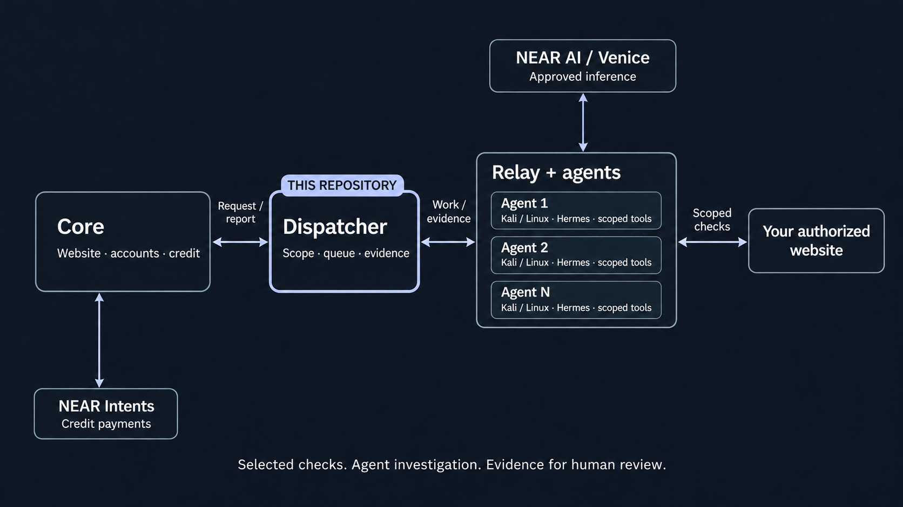

<p align="center"></p>

# Patchriot dispatcher

**Turn an authorized request into bounded agent work.** The dispatcher checks scope and ownership, schedules approved agents and keeps their evidence tied to the request that produced it.

Patchriot is a **pre-penetration testing suite**. Its agents help developers and security researchers investigate web applications and return evidence for human review. They do not replace a human penetration test or certify a target as secure.

[Hosted service](https://patchriot.net) · [Full local setup](https://github.com/adaki2004/patchriot-core#run-locally) · [Architecture](https://patchriot.net/#/docs/infrastructure)

## Architecture



| Repository | Responsibility |
| --- | --- |
| [patchriot-core](https://github.com/adaki2004/patchriot-core) | Website, identity, payments and shared protocol |
| **[patchriot-dispatcher](https://github.com/adaki2004/patchriot-dispatcher)** · you are here | Ownership, staff approval, scheduling, leases, private evidence and reports |
| [patchriot-relay](https://github.com/adaki2004/patchriot-relay) | Enforces scope and runs tools and agents on their machines |

The internal API accepts authenticated requests from core. A separate **agent gateway** accepts signed device requests and exposes no internal administration routes. Agents need the gateway address, not the internal service secret.

For current live assessments, **Scout investigates, then Recon validates and checks a few missed leads**. Different device identities run the two roles; they can still share an operator or host. The scheduler respects each compute group's capacity and keeps queued work from consuming a running role's time allowance.

## Two NEAR building blocks

- **[NEAR AI](https://docs.near.ai/cloud/verification):** supported inference runs through the relay's encrypted, attested route. The dispatcher records the consented model and validates result metadata; it does not attest the operator's host or independently prove a finding.
- **[NEAR Intents / 1Click](https://docs.near-intents.org/integration/distribution-channels/1click-api/about-1click-api):** core reconciles payment and admits funded work. This service does not hold customer money or treasury keys.

NEAR AI and Venice can be primary or backup. Configure approved devices first, then choose fixed routing or balanced provider pools. A settings change affects new requests, never an existing request's consent. Reports disclose actual fallback use; the Venice route does not claim Patchriot-verified NEAR attestation.

## What it enforces

| Boundary | Enforcement |
| --- | --- |
| Ownership | Expiring DNS proof for every target origin, or a recorded staff authorization after independently confirming permission |
| Worker approval | Device approval, private-work approval and explicit staff-approved capabilities; device claims alone are insufficient |
| Scope | Saved origins, methods, checks and account permissions; changing targets requires renewed authorization |
| Credentials | Encrypted at rest and released only to the assigned device's active lease |
| Evidence | Signed, one-use retrieval requests with expiry and nonce replay checks |
| Scheduling | One live execution attempt per role, renewable leases, per-machine capacity and requester limits |
| Completion | Requires usable reports, cleanup, access proof where needed and completed selected checks; two finished agents can still mean `needs_review` |

Optional extra testing context is screened before admission and remains untrusted input. Screening cannot expand scope or grant credentials. Ownership notes are retained as staff records and are **not sent to investigating agents**. Free-text instructions do not replace the relay's enforceable origin/method controls.

## Tools it coordinates

Tools execute on relay hosts, not in this service. Their individual receipts identify what ran.

| Component | Purpose |
| --- | --- |
| [Hermes](https://github.com/NousResearch/hermes-agent) | Investigation and independent follow-up checks |
| [Nuclei](https://github.com/projectdiscovery/nuclei), [ARES-derived fingerprints](https://github.com/Mafifrizi/ARES) | Curated signatures and observed web technologies |
| [ffuf](https://github.com/ffuf/ffuf), [ZAP](https://www.zaproxy.org/), [Schemathesis](https://github.com/schemathesis/schemathesis) | Bounded path, response and observed-schema checks |
| [Chromium](https://www.chromium.org/), [Playwright](https://github.com/microsoft/playwright), [agent-browser](https://github.com/vercel-labs/agent-browser) | Browser exploration and supported login flows |
| [Patchriot adapters](https://github.com/adaki2004/patchriot-relay/tree/main/agent) | Scope controls, selected deeper probes and evidence accounting |

The [checks guide](https://patchriot.net/#/docs/checks) and [relay inventory](https://github.com/adaki2004/patchriot-relay#tool-inventory-and-provenance) describe limits. These integrations do not run unrestricted upstream frameworks or template packs.

## Run locally

Follow the [core setup](https://github.com/adaki2004/patchriot-core#run-locally) for all three services. This repo needs **Rust 1.94.1**, a **PostgreSQL 17 database** and `patchriot-core` beside it for the shared protocol crate. The local guide runs PostgreSQL in Docker and this service natively on macOS or Linux; no separate VM is needed.

```sh
cargo build --locked
umask 077
cp .env.example .env
chmod 600 .env
```

Fill the required fields in [.env.example](.env.example):

| Variable | Why it is needed |
| --- | --- |
| `DATABASE_URL` | Dispatcher-only database; migrations run automatically |
| `PATCHRIOT_INTERNAL_KEY` | Same fresh service secret as core; never give it to a relay |
| `PATCHRIOT_AUDIENCE` | Stable signature namespace; relays must pair with the exact same value |
| `PATCHRIOT_BIND` | Private internal listener; default `127.0.0.1:7411` |
| `PATCHRIOT_CREDENTIAL_KEY` | Separate 32-byte hex secret for grey-box/site-gate credentials; omit for public-only tests |

```sh
set -a; . ./.env; set +a
target/debug/patchriot-dispatcher
```

The process does not load `.env` automatically. Core creates the local admin; this service has no separate browser login. Pair and approve devices through core.

### Configuration that changes the test

| Setting | Default / effect |
| --- | --- |
| `PATCHRIOT_AGENT_ATTEMPT_SECONDS` | 600 seconds per role; maximum 10800. Also configure the relay ceiling. |
| `PATCHRIOT_COMPUTE_GROUP_CONCURRENCY` | 1 per declared machine; accepted range 1–4 |
| `PATCHRIOT_LIVE_REQUESTS_PER_DAY` | 10 new website permission records per requester per day; not HTTP requests made by a scan |
| `PATCHRIOT_LIVE_REVIEWS_PER_REQUESTER` | 3 unfinished assessments, including waiting reservations |
| `PATCHRIOT_JEV_OPENROUTER_KEY` | Optional screening of nonempty extra testing context; omit context when unset |
| `PATCHRIOT_INFERENCE_PRIMARY_MODEL`, `PATCHRIOT_INFERENCE_SECONDARY_MODEL` | Optional fixed route and consented backup; exact supported model names are in the template |
| `PATCHRIOT_INFERENCE_BALANCED_POOLS` | Default false; alternatively select between ready provider pools, each with at least two approved devices |

Do not combine balanced pools with fixed routing or the legacy fallback flag. Template comments describe valid combinations. Matching provider keys stay on relays, not here. The [local guide](https://github.com/adaki2004/patchriot-core#4-configure-near-ai-and-its-backup) uses NEAR AI as primary with Venice as backup, and shows where to create the key files. There is no inference API key to add to this service’s environment.

## Deploying beyond localhost

Keep the internal listener private. Run `patchriot-agent-gateway` for remote relays behind HTTPS or a private mesh. It shares the dispatcher database, audience, credential key, role-time and concurrency settings, but must **not** receive `PATCHRIOT_INTERNAL_KEY`. Local development can use the optional loopback `PATCHRIOT_RELAY_BIND` listener instead.

Back up both the database and credential key securely. Do not rotate the encryption key while saved credentials remain. Keep core, dispatcher/gateway and relay protocol revisions compatible; deploy new capability readers before advertising those capabilities from agents. Drain active work before changing its runtime.

This service trusts its approved operators and the authenticated core. Its shared internal key is not mutual TLS. Device signatures prove possession of a key, not honest execution or true capability claims. [SECURITY.md](SECURITY.md) describes the remaining boundaries.

## Contributing

For installation and your first audit, follow the [complete core walkthrough](https://github.com/adaki2004/patchriot-core#run-locally).

<details>
<summary>Checks after changing the code</summary>

Run these from the dispatcher repository before proposing a code change. They check formatting, compiler warnings and automated tests; they do not start the dispatcher or submit an audit.

```sh
cargo fmt --all --check
cargo clippy --locked --all-targets -- -D warnings
cargo test --locked --all-targets
```

Database integration tests additionally need `PATCHRIOT_TEST_DATABASE_URL` pointing to a separate disposable database. Keep it separate from the installation you use for assessments.

</details>

[License](LICENSE) · [Third-party credits](NOTICE)

> **DON’T TRUST! VERIFY!** Review the service, relay and deployment settings before entrusting private work to an installation. Public source does not change the permissions in this repository's license.
